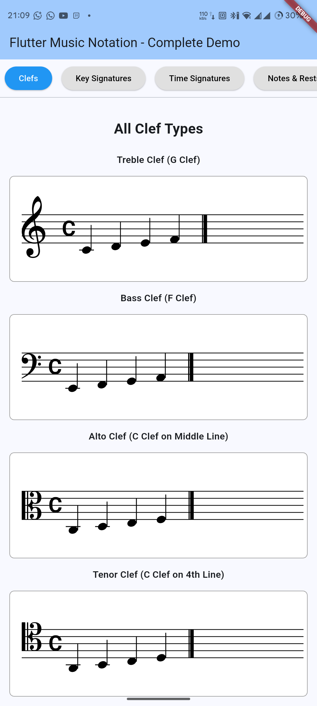
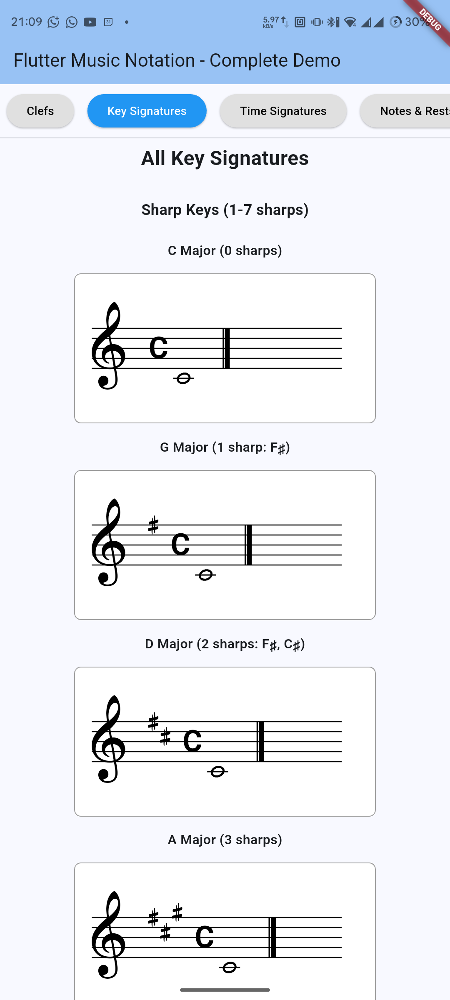
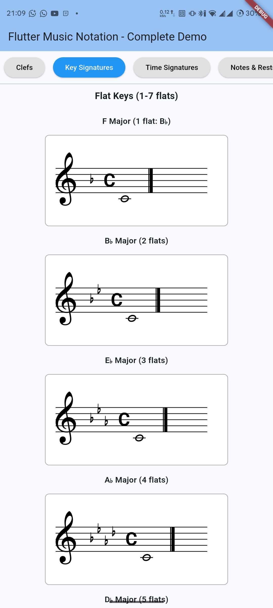
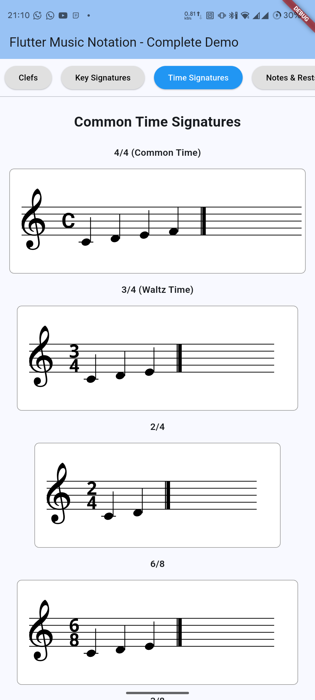
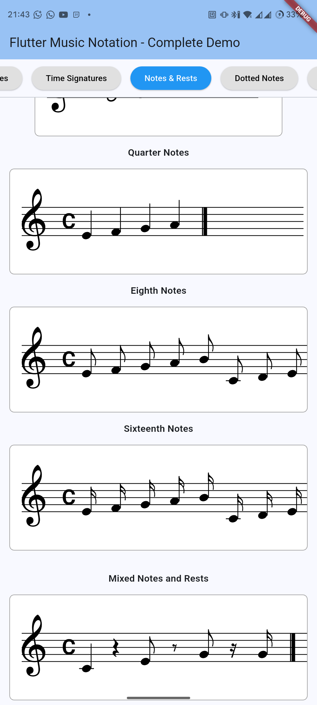
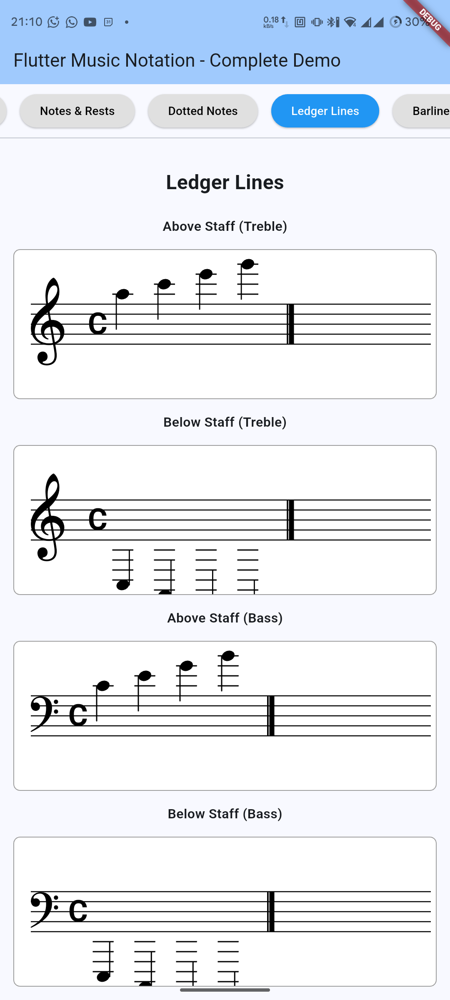
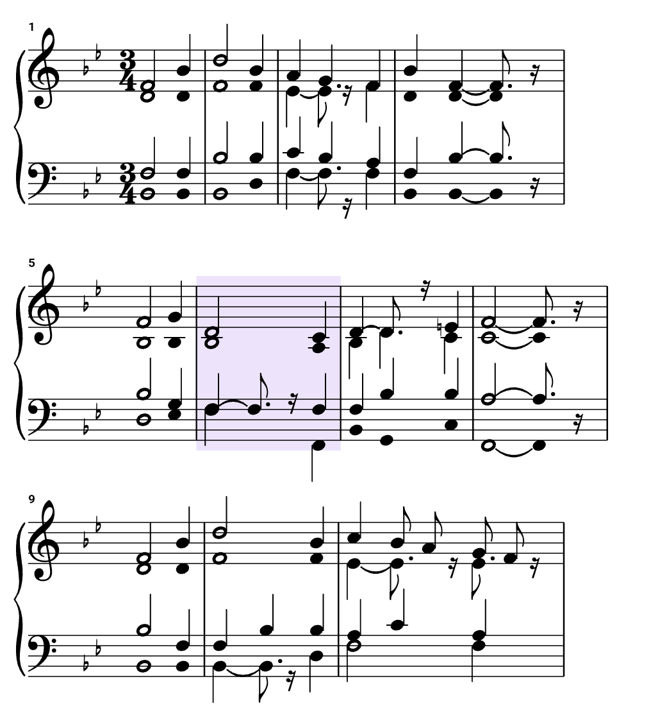
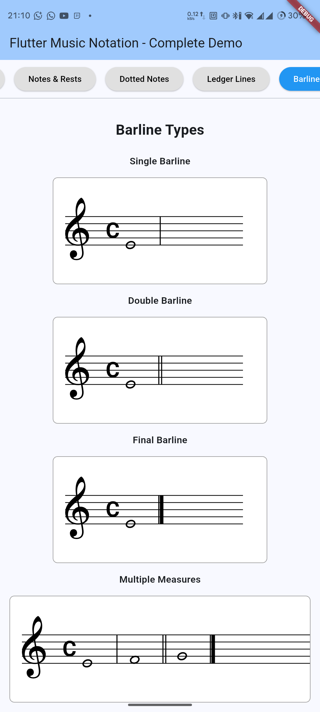

# Flutter Music Notation

A professional music notation rendering library for Flutter that displays standard Western music notation with beautiful, accurate engraving.

[](https://pub.dev/packages/flutter_music_notation)
[](https://opensource.org/licenses/BSD-3-Clause)

## Features

- 🎼 All standard clefs (treble, bass, alto, tenor) and all 15 major and minor key signatures
- 🎶 Time signatures with SMuFL glyphs, including common and cut time
- 🎹 Notes, rests, dots, ledger lines, chords and barlines engraved with the Bravura font
- ♯ Accidentals that follow real engraving rules: by letter name, carried through the bar, with naturals where needed
- 📏 Proportional spacing that scales with the staff size, automatic line breaks that fit the width, and a ragged final line
- 🎹 Grand staff (piano) with brace, with both staves on one rhythmic grid so their notes line up
- 🎶 Four-part (SATB) writing: two voices per staff with their own stems, rests and ties
- 🔗 Beams, ties (within a bar, across barlines and across line breaks), slurs and tuplets
- 🟨 Shade a bar, e.g. the one being played
- 🎧 MIDI import: from a `.mid` file or live keyboard input to clean notation, with quantization, rests, ties, chords, key-aware spelling and key estimation
- ⚡ Playback with real-time note highlighting

## Screenshots

### 🎼 Basic Notation


### 🎵 Key Signatures

]

### 🕒 Time Signatures


### 🎹 Note & Rest Rendering


### 📏 Ledger Lines


### 🎶 Four parts on a grand staff


### 🎯 Multiple Barlines



## Installation

Add this to your package's `pubspec.yaml` file:

```yaml
dependencies:
  flutter_music_notation: ^0.4.0
```

Then run:

```bash
flutter pub get
```

## Quick Start

### Simple Example - Display a C Major Scale

```dart
import 'package:flutter/material.dart';
import 'package:flutter_music_notation/flutter_music_notation.dart';

class MyMusicWidget extends StatelessWidget {
  @override
  Widget build(BuildContext context) {
    // Create a simple C major scale
    final measure = Measure(
      number: 0,
      timeSignature: TimeSignature.fourFour,
      keySignature: KeySignature.cMajor,
      notes: [
        Note(
          pitch: Pitch(noteName: NoteName.C, octave: 4),
          duration: const NoteDuration.quarter(),
          startBeat: 0.0,
        ),
        Note(
          pitch: Pitch(noteName: NoteName.D, octave: 4),
          duration: const NoteDuration.quarter(),
          startBeat: 1.0,
        ),
        Note(
          pitch: Pitch(noteName: NoteName.E, octave: 4),
          duration: const NoteDuration.quarter(),
          startBeat: 2.0,
        ),
        Note(
          pitch: Pitch(noteName: NoteName.F, octave: 4),
          duration: const NoteDuration.quarter(),
          startBeat: 3.0,
        ),
      ],
      endBarline: BarlineType.final_,
    );

    return NotationView(
      measures: [measure],
      config: const NotationConfig(
        staffSpaceSize: 12,
        clef: ClefType.treble,
      ),
    );
  }
}
```

## Core Concepts

### 1. Measures

A `Measure` is the fundamental container for musical notation. It includes:
- Time signature
- Key signature
- Notes and rests
- Barline type

```dart
final measure = Measure(
  number: 0,
  timeSignature: TimeSignature.fourFour,
  keySignature: KeySignature.gMajor,
  notes: [...],
  rests: [...],
  endBarline: BarlineType.double_,
);
```

### 2. Notes

Notes have a pitch, duration, and position. `startBeat` counts quarter-note beats from the start of the bar, whatever the time signature:

```dart
final note = Note(
  pitch: Pitch(noteName: NoteName.C, octave: 4),
  duration: const NoteDuration.quarter(),
  startBeat: 0.0,
);
```

Notes that start together in the same `voice` form a chord. For two voices on one staff, give them different voices and stems (see [Four-part writing](#four-part-writing-on-a-grand-staff)). `tieToNext: true` ties a note to the next note of the same pitch and voice that starts where it ends, in the same bar or at the start of the next.

### 3. Pitch

Pitches use scientific pitch notation:

```dart
// Middle C (C4)
final middleC = Pitch(noteName: NoteName.C, octave: 4);

// F# in octave 5
final fSharp = Pitch(
  noteName: NoteName.F,
  accidental: Accidental.sharp,
  octave: 5,
);

// Create from MIDI number
final pitch = Pitch.fromMidiNumber(60); // C4
```

### 4. Duration

Note durations with dots and tuplets:

```dart
// Quarter note
const quarter = NoteDuration.quarter();

// Dotted half note
const dottedHalf = NoteDuration(type: DurationType.half, dots: 1);

// Eighth note triplet
const tripletEighth = NoteDuration(
  type: DurationType.eighth,
  tuplet: Tuplet.triplet,
);
```

### 5. Rests

Rests work similarly to notes:

```dart
const rest = Rest(
  duration: NoteDuration.quarter(),
  startBeat: 1.0,
);
```

On a staff with two voices, give a rest its `voice`: an upper (even) voice's rest is drawn higher and a lower (odd) voice's lower, clear of the other voice. A rest without a voice is centred, as when both voices rest together.

## Key Signatures

All 15 major/minor key signatures are supported:

```dart
// Sharp keys
KeySignature.cMajor      // No sharps or flats
KeySignature.gMajor      // 1 sharp (F♯)
KeySignature.dMajor      // 2 sharps (F♯, C♯)
KeySignature.aMajor      // 3 sharps
KeySignature.eMajor      // 4 sharps
KeySignature.bMajor      // 5 sharps
KeySignature.fSharpMajor // 6 sharps
KeySignature.cSharpMajor // 7 sharps

// Flat keys
KeySignature.fMajor      // 1 flat (B♭)
KeySignature.bFlatMajor  // 2 flats (B♭, E♭)
KeySignature.eFlatMajor  // 3 flats
KeySignature.aFlatMajor  // 4 flats
KeySignature.dFlatMajor  // 5 flats
KeySignature.gFlatMajor  // 6 flats
KeySignature.cFlatMajor  // 7 flats

// Minor keys also available (e.g., KeySignature.aMinor)
```

## Time Signatures

Common time signatures:

```dart
TimeSignature.fourFour   // 4/4 (Common time)
TimeSignature.threeFour  // 3/4 (Waltz)
TimeSignature.twoFour    // 2/4
TimeSignature.sixEight   // 6/8
TimeSignature.threeEight // 3/8
TimeSignature.twelveEight // 12/8
TimeSignature.twoTwo     // 2/2 (Cut time)

// Custom time signatures
const customTime = TimeSignature(beats: 5, beatUnit: 4); // 5/4
```

## Clefs

Four standard clefs:

```dart
ClefType.treble  // G clef (most common)
ClefType.bass    // F clef (lower instruments)
ClefType.alto    // C clef on middle line (viola)
ClefType.tenor   // C clef on 4th line (cello, bassoon)
```

## Playback (Phase 2 Feature)

Add synchronized playback with note highlighting:

```dart
class MyMusicPlayer extends StatefulWidget {
  @override
  State<MyMusicPlayer> createState() => _MyMusicPlayerState();
}

class _MyMusicPlayerState extends State<MyMusicPlayer> {
  late PlaybackController _controller;
  late List<Note> _notes;

  @override
  void initState() {
    super.initState();
    _notes = _createNotes();
    _controller = PlaybackController(
      notes: _notes,
      beatsPerMinute: 120.0,
    );
  }

  @override
  Widget build(BuildContext context) {
    return Column(
      children: [
        // Notation with playback
        NotationView(
          measures: [_createMeasure()],
          playbackController: _controller,
        ),
        
        // Playback controls
        Row(
          children: [
            IconButton(
              icon: Icon(_controller.isPlaying ? Icons.pause : Icons.play_arrow),
              onPressed: () {
                if (_controller.isPlaying) {
                  _controller.pause();
                } else {
                  _controller.play();
                }
              },
            ),
            IconButton(
              icon: const Icon(Icons.stop),
              onPressed: () => _controller.stop(),
            ),
          ],
        ),
      ],
    );
  }

  @override
  void dispose() {
    _controller.dispose();
    super.dispose();
  }
}
```

## From MIDI

Turn a `.mid` file or notes recorded from a keyboard into notation:

```dart
final midi = MidiData(
  notes: recordedNotes, // MidiNote(midiNumber, velocity, startTime ms, endTime ms)
  timeSignatureNumerator: 4,
  timeSignatureDenominator: 4,
  beatsPerMinute: 96,
  ticksPerQuarterNote: 480,
);
final converter = MidiToNotation(midiData: midi);

// Piano: notes from middle C up go to the upper staff.
NotationView(grandStaff: converter.toGrandStaff(), config: const NotationConfig(useSystemLayout: true));

// Or a single staff in the clef that suits the music.
NotationView(
  measures: converter.toSingleStaff(),
  config: NotationConfig(clef: converter.suggestedClef(), useSystemLayout: true),
);
```

The converter:
- picks the coarsest rhythmic grid that explains the playing, so small timing wobbles don't turn into tiny note values (or pass `gridResolution` yourself)
- trims the silence before the first bar, groups notes pressed together into chords and trims legato overlaps
- fills every gap with rests, so each bar adds up
- splits notes at barlines and beats and joins the pieces with ties
- spells pitches from the key (F♯ in G major, C♭ in C♭ major, G♯ as the leading note of A minor)

For a recording with no key, `converter.estimateKey()` suggests one. Pass its `accidentals` and `isMinor` as `keySignatureSharps` and `keySignatureIsMinor`.

## Four-part writing on a grand staff

Hymns and choral music put soprano and alto on the treble staff and tenor and bass on the bass staff. Give each part its own voice (0 and 1 on the upper staff, 2 and 3 on the lower) with the upper part's stems up and the lower part's down. Ties follow the stems: the upper voice ties above, the lower below.

```dart
Note part(int midi, NoteDuration d, double beat, int voice, {bool tie = false}) => Note(
  pitch: Pitch.fromMidiNumber(midi, preferredAccidental: Accidental.flat),
  duration: d,
  startBeat: beat,
  voice: voice,
  stemDirection: voice.isEven ? StemDirection.up : StemDirection.down,
  tieToNext: tie,
);

const key = KeySignature(accidentals: -2); // B flat major
const time = TimeSignature(beats: 3, beatUnit: 4);

final bar1 = (
  upper: Measure(number: 0, timeSignature: time, keySignature: key, notes: [
    part(70, const NoteDuration.half(), 0, 0), part(72, const NoteDuration.quarter(), 2, 0), // soprano
    part(65, const NoteDuration.half(), 0, 1, tie: true), part(65, const NoteDuration.quarter(), 2, 1), // alto, tied
  ]),
  lower: Measure(number: 0, timeSignature: time, keySignature: key, notes: [
    part(62, const NoteDuration.quarter(), 0, 2), part(63, const NoteDuration.half(), 1, 2), // tenor
    part(46, const NoteDuration.dottedHalf(), 0, 3), // bass
  ]),
);

NotationView(
  grandStaff: GrandStaff(upperStaff: [bar1.upper /* , … */], lowerStaff: [bar1.lower /* , … */]),
  config: const NotationConfig(
    staffSpaceSize: 8,          // spacing scales with it
    useSystemLayout: true,      // break into systems that fit the width
    highlightedMeasure: 0,      // shade a bar, e.g. the one playing
  ),
)
```

With `useSystemLayout` and no `height`, the view takes the available width and sizes itself to the systems it needs, so it can sit in a scrolling column. To know the size in advance, `GrandStaffLayout.forConfig(grandStaff, config, width)` returns the same layout the view paints, including `totalHeight`.

Each system reserves room for its clef, key signature and (on the first) time signature, and bars are measured with both staves together, so a full system ends at the right margin. Cap the bars per system with `lineBreakConfig: LineBreakConfig(targetLineWidth: width, maxMeasuresPerLine: 4)`.

## Configuration

Customize the notation appearance:

```dart
NotationView(
  measures: measures,
  config: NotationConfig(
    staffSpaceSize: 14.0,          // Size of a staff space (default: 12)
    staffLineColor: Colors.black,
    noteColor: Colors.black,
    activeNoteColor: Colors.green, // Notes during playback
    clef: ClefType.treble,
    useSystemLayout: true,         // Wrap onto multiple lines
    enableBeaming: true,           // Beam eighths and shorter
    showTimeSignature: true,       // Hide the time signature with false
    showKeySignatureOnEachSystem: true,
    expandWidth: false,            // Justify every system, the last included, to the full width
    leadingSpace: 0.0,             // Extra space before the first note
    barlineToClefSpace: 0.0,       // Space between the start barline and the clef
    highlightedMeasure: null,      // Measure.number of a bar to shade
    highlightColor: Color(0x33FFC107),
    spacingEngine: SpacingPresets.normal, // or tight, loose, uniform
    width: 400.0,
  ),
)
```

Spacing presets are given at the default 12 px staff space and scale with `staffSpaceSize`, so a smaller staff is also narrower and fits more bars on a line.

Bar numbers are drawn above the start of each system as `Measure.number + 1`, so number measures from 0.

## Examples

See the `example/` directory for comprehensive examples including:

1. **All Clefs** - Treble, bass, alto, and tenor clefs
2. **All Key Signatures** - 15 major keys with proper sharps/flats
3. **Time Signatures** - 4/4, 3/4, 6/8, 2/2, and more
4. **Note Durations** - Whole, half, quarter, eighth, sixteenth notes
5. **Dotted Notes** - Single and double dots
6. **Ledger Lines** - Notes above and below the staff
7. **Barlines** - Single, double, and final barlines
8. **Complete Pieces** - Ode to Joy, Mary Had a Little Lamb, Twinkle Twinkle

Run the example app:

```bash
cd example
flutter run
```

## Roadmap

Done: core engraving, layout and spacing, grand staff, two voices per staff, beams, ties, slurs, tuplets and MIDI import.

Next:
- Dynamics (f, p, hairpins) and articulations (staccato, accent, fermata)
- Unisons and seconds between two voices on one staff (noteheads shared or offset)
- Triplet detection in MIDI input
- Smarter hand split for piano input

## Architecture

The library follows a clean, modular architecture:

```
Models → Geometry → Layout → Rendering → Widgets
  ↓         ↓          ↓         ↓          ↓
 Data   Positions  Spacing   Drawing   Display
```

- **Models**: Immutable data structures (Note, Pitch, Duration, Measure)
- **Geometry**: Staff position calculations, unit conversions
- **Layout**: Spacing algorithms, collision detection (Phase 4)
- **Rendering**: Low-level drawing of notation elements
- **Widgets**: High-level Flutter widgets for easy integration

## Design Principles

1. **Professional Quality**: SMuFL-compliant glyphs, proper engraving standards
2. **Performance**: 60fps rendering, efficient caching
3. **Immutability**: All models are immutable for predictable behavior
4. **Testability**: Every component is independently testable
5. **Extensibility**: Easy to add new features and customization

## Requirements

- Flutter 3.35 or higher
- Dart 3.9 or higher

## Contributing

Contributions are welcome! Please see [CONTRIBUTING.md](CONTRIBUTING.md) for guidelines.

### Development Setup

```bash
# Clone the repository
git clone https://github.com/adelaykay/flutter_music_notation.git
cd flutter_music_notation

# Install dependencies
flutter pub get

# Run tests
flutter test

# Run example
cd example
flutter run
```

## Contributors

- **Julien Bourgeois** ([@Julien5](https://github.com/Julien5)): `showTimeSignature`, `expandWidth`, `leadingSpace`, `barlineToClefSpace`, start barlines, the grand staff brace and spacing fix, and the golden tests.

## License

This project is licensed under the BSD-3-Clause License - see the [LICENSE](LICENSE) file for details.

The Bravura font used for music symbols is licensed under the SIL Open Font License.

## Acknowledgments

- **Bravura** and **Petaluma** © Steinberg Media Technologies GmbH
- **Music Engraving**: Based on best practices from "Behind Bars" by Elaine Gould

## Support

- 📖 [Documentation](https://pub.dev/documentation/flutter_music_notation/latest/)
- 💬 [GitHub Issues](https://github.com/adelaykay/flutter_music_notation/issues)
- 📧 Email: hello@empyrealworks.com

## Related Projects

- [simple_sheet_music](https://pub.dev/packages/simple_sheet_music) - Another music notation package
- [flutter_midi_16kb](https://pub.dev/packages/flutter_midi_16kb) - MIDI playback for Flutter

---

Made with ♥ by [Empyreal Digital Works]